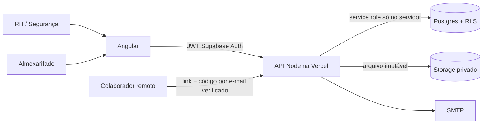

# EPI ERP

Primeira versão evolutiva de gestão de Equipamentos de Proteção Individual: estoque, colaboradores, montagem visual de ficha, emissão imutável e opção de assinatura presencial ou eletrônica simples. Interface em Angular/TypeScript, API Node/TypeScript e Supabase Postgres/Auth/Storage. O projeto começa sem dados de produção.

> O repositório original continha apenas a licença. A fotografia fornecida orienta os campos, mas não equivale ao PDF original. A exportação atual traz o aviso **MODELO PROVISÓRIO** e precisa ser validada contra o documento fonte antes de uso oficial.

## Arquitetura



O banco impede quantidade diferente de 1 na ficha e saída diferente de -1, e a função `issue_sheet` faz baixa e emissão na mesma transação. O PDF é gerado e guardado em bucket privado; seu hash SHA-256 fica na ficha imutável. A assinatura gera evidência destacada, sem reescrever o PDF. A confirmação de recebimento físico é independente. A API exige JWT e perfil por organização; links externos só expõem o documento após código enviado ao e-mail verificado. O link deve ser transmitido por outro canal.

## Rodar no Windows / PowerShell

Requisitos: Node.js 24.15+, npm, um projeto **Supabase de desenvolvimento** e SMTP para verificação/assinatura remota.

1. No Supabase de desenvolvimento, rode a migration `supabase/migrations/202610190001_init.sql` pelo SQL Editor. Confira primeiro o projeto selecionado; não rode em produção sem revisão e backup.
2. Crie o primeiro usuário em **Authentication > Users**. Crie uma organização e a associação desse usuário no SQL Editor:

```sql
insert into public.organizations(name) values ('Minha empresa') returning id;
insert into public.memberships(organization_id,user_id,role)
values ('UUID_DA_ORGANIZACAO','UUID_DO_USUARIO_AUTH','ADMIN');
```

3. Copie `.env.example` para `.env` e preencha com credenciais **do projeto de desenvolvimento**. Gere `TOKEN_PEPPER` e `CRON_SECRET` aleatórios, com no mínimo 32 caracteres. `SUPABASE_SERVICE_ROLE_KEY` nunca vai para o Angular. SMTP é obrigatório para verificar e-mail e assinar remotamente.
4. No PowerShell, na raiz do repositório:

```powershell
npm ci --install-strategy=nested
npm run dev:api
```

Abra outra janela PowerShell na mesma pasta:

```powershell
npm run dev:web
```

O Angular abre em `http://localhost:4200`; a API em `http://localhost:3000`. O proxy local encaminha `/api` para a API. A API lê `.env` via `node --env-file=.env` (ver script de desenvolvimento). Os usuários comuns precisam de uma linha em `memberships` com papel `ALMOXARIFADO`, `RH` ou `SEGURANCA`.

## Fluxo funcional

1. Almoxarifado: produto (categoria, CA quando aplicável, marca/modelo/risco), variação (tamanho/SKU), lote (fornecedor/datas) e entrada de estoque.
2. RH/Segurança: colaborador (nome, registro, setor, cargo, admissão/demissão), depois escolha de cards de EPI e lote. Cada linha vale **1**. Escolha assinatura manual ou eletrônica. A emissão congela a versão e baixa 1 por linha.
3. Manual: baixe/imprima a ficha, obtenha a assinatura presencial fora do sistema. O estado fica pendente até um fluxo de captura da evidência manual ser implementado; o sistema não afirma que uma linha vazia foi assinada.
4. Eletrônica: verifique o e-mail pessoal do colaborador, gere link de 24 h e envie por canal diferente do e-mail. O colaborador solicita código de 6 dígitos, abre o PDF exato, aceita os termos e confirma. O link é consumido uma vez. Esta versão registra **assinatura eletrônica simples**, sem alegar nível avançado ou qualificado.
   Antes de cadastrar/verificar o e-mail, o RH precisa conferir presencialmente ou por procedimento independente que o endereço pertence ao colaborador. O sistema sozinho não prova essa titularidade; quem controla o cadastro poderia cadastrar um endereço próprio. Não use o fluxo remoto em produção sem esse controle e validação jurídica.
5. Após entrega real, um operador autorizado registra o recebimento físico em ação distinta. Assinatura remota não marca recebimento automaticamente.

## Verificação e publicação

```powershell
npm run typecheck
npm test
npm run build
```

Para GitHub, faça revisão dos arquivos e segredos (`git status`, `git diff`), crie commit e envie uma branch para `TechHero-bit/EPI-ERP`. `.env` está ignorado. Para Vercel, importe o repositório, use a raiz como diretório do projeto, configure as variáveis do `.env.example` em ambiente **Preview** com Supabase de desenvolvimento, ajuste `APP_ORIGIN` para o domínio Preview e valide `/api/health`. Só promova a Production depois de validar migrations, RLS, SMTP, PDF original, retenção e jurídico.

## Estado e pendências

- Implementados: RBAC na API, RLS de leitura, estoque transacional, ficha versionada e imutável, PDF/Excel provisórios, Storage privado, assinatura remota por link e código, trilha de auditoria básica e confirmação de recebimento separada.
- A fotografia indica nome, registro, função, admissão, demissão, data de emissão/entrega, descrição, CA, marca e risco como campos de montagem. Quantidade é fixa em 1. Rubrica por linha, data de devolução e M.D. não aparecem na montagem.
- Faltam o PDF original e a marcação inequívoca dos campos vermelhos para ajustar o layout e o texto com fidelidade. Também faltam testes de integração contra Supabase de desenvolvimento e revisão jurídica/operacional antes de uso real.
- FaceMatch está **desativado**. A segunda etapa requer avaliação de necessidade/base legal e impacto LGPD, consentimento quando adequado, alternativa de igual acesso, prova de vida, verificação 1:1, revogação, retenção/exclusão e orçamento de fornecedor. Não há provedor facial nem Python integrado nesta versão.
- A rotina diária da Vercel limpa IP e agente de assinaturas após `IP_RETENTION_DAYS` (padrão 90). A retenção de logs, e-mails e PDFs, proteção antiautomação distribuída, captura da assinatura manual digitalizada, backups e testes RLS por papel precisam ser definidos antes de produção.

Veja [arquitetura e decisões](docs/ARCHITECTURE.md) e [contrato OpenAPI](docs/openapi.yaml).
